# 🚗 Bão de Roda 🏔️

> [!NOTE]
> Sistema web de **aluguel de carros** em que clientes fazem pedidos pela Internet e agentes (empresas e bancos) analisam o pedido financeiramente, executam o contrato e, no caso dos bancos, concedem crédito. **Valor principal:** todo o ciclo do aluguel (pedido, análise, contrato e crédito) acompanhado em um só lugar, com o status sempre visível para o cliente.

<table>
  <tr>
    <td width="800px">
      <div align="justify">
        O <b>Bão de Roda</b> é o protótipo desenvolvido no <b>Laboratório 02 (LAB02)</b> da disciplina de <i>Desenvolvimento e Integração de Aplicações Web</i> (Engenharia de Software, PUC Minas). Ele apoia a gestão de aluguéis de automóveis: o <b>cliente</b> se cadastra, faz login, cria, modifica, consulta e cancela pedidos; o <b>agente</b> (empresa ou banco) modifica e avalia pedidos, executa o contrato de aluguel e, se for banco, associa um contrato de crédito. A aplicação segue a arquitetura <b>MVC</b>, com <b>Spring Boot</b> no back-end, <b>React + Vite</b> no front-end e <b>Supabase (PostgreSQL)</b> como banco de dados.
      </div>
    </td>
    <td>
      <div>
        
      </div>
    </td>
  </tr>
</table>

---

## 🚧 Status do Projeto

        

**Situação:** ✅ protótipo funcional concluído (login, CRUD de cliente, pedidos com status, avaliação, contrato e crédito).

---

## 📚 Índice

- [Links Úteis](#-links-úteis)
- [Sobre o Projeto](#-sobre-o-projeto)
- [Funcionalidades Principais](#-funcionalidades-principais)
- [Tecnologias Utilizadas](#-tecnologias-utilizadas)
- [Arquitetura](#-arquitetura)
  - [Exemplos de diagramas](#exemplos-de-diagramas)
- [Instalação e Execução](#-instalação-e-execução)
  - [Pré-requisitos](#pré-requisitos)
  - [Variáveis de Ambiente](#-variáveis-de-ambiente)
    - [1 Back-end (Spring Boot)](#1-back-end-spring-boot)
    - [2 Front-end (React, Vite)](#2-front-end-react-vite)
    - [3 Publicação opcional na Vercel](#3-publicação-opcional-na-vercel)
  - [Instalação de Dependências](#-instalação-de-dependências)
    - [Front-end (React)](#front-end-react)
    - [Back-end (Spring Boot)](#back-end-spring-boot)
  - [Inicialização do Banco de Dados (Supabase)](#-inicialização-do-banco-de-dados-supabase)
  - [Como Executar a Aplicação](#-como-executar-a-aplicação)
    - [Terminal 1: Back-end (Spring Boot)](#terminal-1-back-end-spring-boot)
    - [Terminal 2: Front-end (React, Vite)](#terminal-2-front-end-react-vite)
    - [Execução Local Completa com Docker Compose](#-execução-local-completa-com-docker-compose)
- [Deploy](#-deploy)
- [Estrutura de Pastas](#-estrutura-de-pastas)
- [Demonstração](#-demonstração)
  - [Aplicativo Mobile](#-aplicativo-mobile)
  - [Aplicação Web](#-aplicação-web)
  - [Exemplo de saída no Terminal (API)](#-exemplo-de-saída-no-terminal-para-back-end-api-cli)
- [Testes](#-testes)
- [Documentações utilizadas](#-documentações-utilizadas)
- [Autores](#-autores)
- [Contribuição](#-contribuição)
- [Agradecimentos](#-agradecimentos)
- [Licença](#-licença)

---

## 🔗 Links Úteis

- 🌐 **Demo Online:** não publicada. O sistema é executado localmente, conforme a seção [Instalação e Execução](#-instalação-e-execução).
  > 💻 **Descrição:** a publicação em produção não é exigida para este laboratório; o protótipo é apresentado rodando na máquina do autor.
- 📱 **Download Mobile:** não se aplica (aplicação web com layout responsivo).
- 📖 **Documentação:** [Pasta `docs/`](./docs)
  > 📚 **Descrição:** diagramas UML (casos de uso, classes e pacotes), [histórias de usuário](./docs/Historia-Usuario.md) e o [roteiro de testes](./docs/testes.md).
- 🗂️ **Repositório:** `https://github.com/DavidAurelio07/desenvolvimento-e-integracao-de-aplicacoes-web/tree/main/AluguelCarros`

---

## 📝 Sobre o Projeto

**Por que existe:** o enunciado do LAB02 pede um sistema de apoio à gestão de aluguéis de automóveis, que permita efetuar, cancelar e modificar pedidos pela Internet, com análise financeira e contratos.

**Qual problema resolve:** centraliza em uma única aplicação o que normalmente se espalha entre ligações, planilhas e e-mails: o cliente pede o carro, o agente avalia a capacidade financeira, o contrato é formalizado e, se houver financiamento, o crédito do banco fica ligado ao aluguel.

**Contexto:** acadêmico (Engenharia de Software, PUC Minas), com foco em modelagem (UML), arquitetura **MVC** e alinhamento entre modelo e código.

**Onde pode ser usado:** locadoras de veículos, empresas com frota própria e bancos que financiam aluguéis, em cenários reais ou simulados.

**Valor entregue:**

- ao **cliente**: cadastro simples, pedido em poucos cliques e acompanhamento do status em uma linha do tempo;
- ao **agente**: fila de pedidos, parecer financeiro com justificativa, contrato e crédito registrados no mesmo fluxo.

> [!NOTE]
> O nome _Bão de Roda_ brinca com o jeito mineiro de falar ("bão") e com a ideia de pôr o carro na estrada. A identidade visual (verde-escuro, creme e amarelo-ouro) vem das montanhas, da vegetação e da arquitetura de Minas Gerais.

---

## ✨ Funcionalidades Principais

- 🔐 **Autenticação segura:** cadastro prévio e login com usuário e senha; senhas criptografadas (BCrypt) e sessão por token JWT.
- 👤 **CRUD de cliente:** cadastro, consulta, alteração e exclusão (RG, CPF, nome, endereço, profissão e até **3** entidades empregadoras com os respectivos rendimentos).
- 🧾 **Pedidos de aluguel (cliente):** introduzir, modificar, consultar e cancelar pedidos, com status e linha do tempo.
- ⚖️ **Análise financeira (agente):** modificar e avaliar pedidos, com parecer positivo ou negativo e justificativa.
- 📑 **Contrato de aluguel:** o agente executa o contrato de pedidos aprovados; o **tipo de contrato** define se o automóvel passa a ser propriedade do cliente, da empresa ou do banco.
- 🏦 **Contrato de crédito:** o banco associa ao aluguel um contrato de crédito (valor financiado, juros e prazo).
- 🚘 **Automóveis:** cadastro e edição (matrícula, ano, marca, modelo e placa) com foto por link.
- 📱 **Layout responsivo** e interface com a identidade visual mineira.

### ✅ Atendimento aos requisitos do enunciado

| Requisito do LAB02                                            | Como foi atendido                                                   |
| :------------------------------------------------------------ | :------------------------------------------------------------------ |
| Java JDK 25, Spring Boot 4.0.x, Maven                         | Java 25, Spring Boot 4.0.8 e Maven Wrapper                          |
| React + Vite no front-end                                     | React 19 + Vite 8 (pasta `frontend/`)                               |
| Supabase (PostgreSQL)                                         | Banco no Supabase, acessado por JPA/Hibernate                       |
| Arquitetura MVC                                               | Controller, Service e Repository/Model no back-end; React como View |
| Login obrigatório (usuário e senha)                           | Spring Security + JWT; rotas do front protegidas por perfil         |
| Clientes: introduzir, modificar, consultar e cancelar pedidos | Telas **Novo pedido**, **Meus pedidos** e **Detalhe do pedido**     |
| Agentes: modificar e avaliar pedidos                          | Tela de detalhe do pedido com edição e painel de análise financeira |
| Execução do contrato após parecer positivo                    | Painel **Executar contrato** em pedidos aprovados                   |
| Automóvel como propriedade de cliente, empresa ou banco       | Campo "tipo de contrato" define o proprietário do carro             |
| Contrato de crédito concedido por banco                       | Painel **Conceder crédito**, exclusivo de bancos                    |
| Dados do contratante e até 3 rendimentos                      | Cadastro de cliente com limite validado no front e no back          |
| CRUD de cliente                                               | Cadastro, **Meu cadastro** (consulta e alteração) e exclusão        |
| Protótipo: criar e visualizar o status do pedido              | Lista de pedidos com filtros e linha do tempo do status             |
| Modelagem (casos de uso, histórias, classes e pacotes)        | Pasta [`docs/`](./docs)                                             |

### 👥 Perfis e permissões

| Perfil               | Pode                                                                                                                           |
| :------------------- | :----------------------------------------------------------------------------------------------------------------------------- |
| **Cliente**          | Gerenciar o próprio cadastro; criar, modificar (em análise), consultar e cancelar os próprios pedidos; ver contrato e crédito. |
| **Agente (empresa)** | Ver todos os pedidos; modificar e avaliar; executar contrato (própria do cliente ou da empresa); gerenciar automóveis.         |
| **Agente (banco)**   | Tudo o que a empresa faz, com contrato de propriedade do cliente ou do banco, e ainda conceder contrato de crédito.            |

---

## 🛠 Tecnologias Utilizadas

### 💻 Front-end

- **Framework/Biblioteca:** React 19
- **Linguagem/Superset:** JavaScript (ES6+, JSX)
- **Roteamento e HTTP:** React Router 7 e Axios
- **Estilização:** CSS puro, com um arquivo por página e por componente e variáveis CSS para a paleta de cores
- **Gerenciamento de Estado:** Context API (autenticação) e `useState`
- **Build Tool:** Vite 8
- **Tipografia:** Fraunces e Inter (Google Fonts)

### 🖥️ Back-end

- **Linguagem/Runtime:** Java 25 (JDK)
- **Framework:** Spring Boot 4.0.8 (Spring Web MVC, Spring Data JPA, Bean Validation e Spring Security)
- **Banco de Dados:** PostgreSQL hospedado no Supabase
- **ORM / Query Builder:** Hibernate/JPA (herança `JOINED` para `Usuario`, `Cliente` e `Agente`)
- **Autenticação:** JWT (biblioteca JJWT 0.12.6) e senhas com BCrypt
- **Build:** Apache Maven (Maven Wrapper)

### 📱 Mobile (Opcional)

- Não se aplica. A interface é responsiva e funciona em telas de celular pelo navegador.

### ⚙️ Infraestrutura & DevOps

- **Containerização:** não utilizada (o banco é um serviço em nuvem).
- **Cloud:** Supabase (PostgreSQL gerenciado). Publicação opcional do front-end na Vercel.
- **Controle de versão:** Git e GitHub.

---

## 🏗 Arquitetura

O sistema segue a arquitetura **MVC** e é dividido em dois subsistemas, como no enunciado: um para a **gestão de pedidos e contratos** (back-end REST) e outro para a **construção dinâmica das páginas web** (front-end React).

**Visão geral:**

- **View:** aplicação React (SPA) em `frontend/`, que consome a API REST.
- **Controller:** classes `@RestController` que recebem as requisições, validam os dados de entrada e delegam ao serviço.
- **Model:** entidades JPA, repositórios e regras de negócio na camada de serviço.

**Principais componentes do back-end** (pacote `com.example.AluguelCarros`):

| Pacote       | Papel                                                                                                              |
| :----------- | :----------------------------------------------------------------------------------------------------------------- |
| `controller` | Endpoints REST (`Auth`, `Cliente`, `Automovel`, `Pedido`, `Contrato`).                                             |
| `service`    | Regras de negócio (cadastro, pedidos, avaliação, contrato e crédito, autenticação, JWT e carga de dados iniciais). |
| `repository` | Interfaces Spring Data JPA para acesso ao banco.                                                                   |
| `model`      | Entidades persistentes e enumerações (`StatusPedido`, `ParecerFinanceiro`, `TipoContrato`).                        |
| `dto`        | Objetos de entrada e saída da API (records), sem dependência das entidades.                                        |
| `security`   | Configuração do Spring Security, filtro JWT e CORS.                                                                |
| `exception`  | Exceções de negócio e tratamento global de erros.                                                                  |

**Padrões de design adotados:** Repository, Service Layer, DTO, Injeção de Dependência, _Global Exception Handler_ e Provider/Context no front-end.

**Decisões arquiteturais importantes:**

- `Cliente` e `Agente` (`Empresa` e `Banco`) herdam de `Usuario`, o que permite um único fluxo de login para todos.
- O proprietário do `Automovel` aponta para `Usuario`, pois pode ser cliente, empresa ou banco conforme o tipo de contrato.
- Os DTOs não dependem das entidades; a conversão é feita na camada de serviço.
- Autenticação _stateless_ com JWT e senhas armazenadas com BCrypt.
- O esquema do banco é gerado pelo Hibernate (`ddl-auto=update`), adequado a um protótipo.

**Trade-offs e limitações:** não há testes automatizados; o esquema não usa migrações versionadas (Flyway/Liquibase); a foto do carro depende do site que a hospeda; e não há controle de disponibilidade do automóvel entre pedidos.

### Exemplos de diagramas

> Os arquivos-fonte (PlantUML) ficam em [`docs/`](./docs); as imagens exportadas ficam em `docs/img/`.

|                               Diagrama de Casos de Uso                               |                    Diagrama de Classes                     |
| :----------------------------------------------------------------------------------: | :--------------------------------------------------------: |
|    |  [Ver diagrama de clases](./docs/diagrama-de-classes.pdf)  |
|                        **Diagrama de Pacotes (Visão Lógica)**                        |                  **Histórias de Usuário**                  |
|  | [Ver histórias de usuário](./docs/historias-de-usuario.md) |

#### Fluxo de autenticação

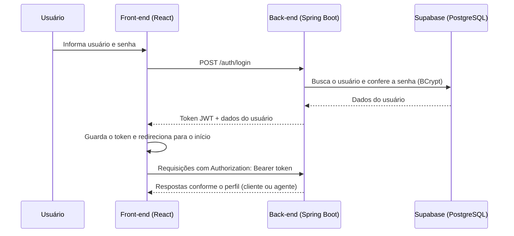

#### Ciclo de vida do pedido

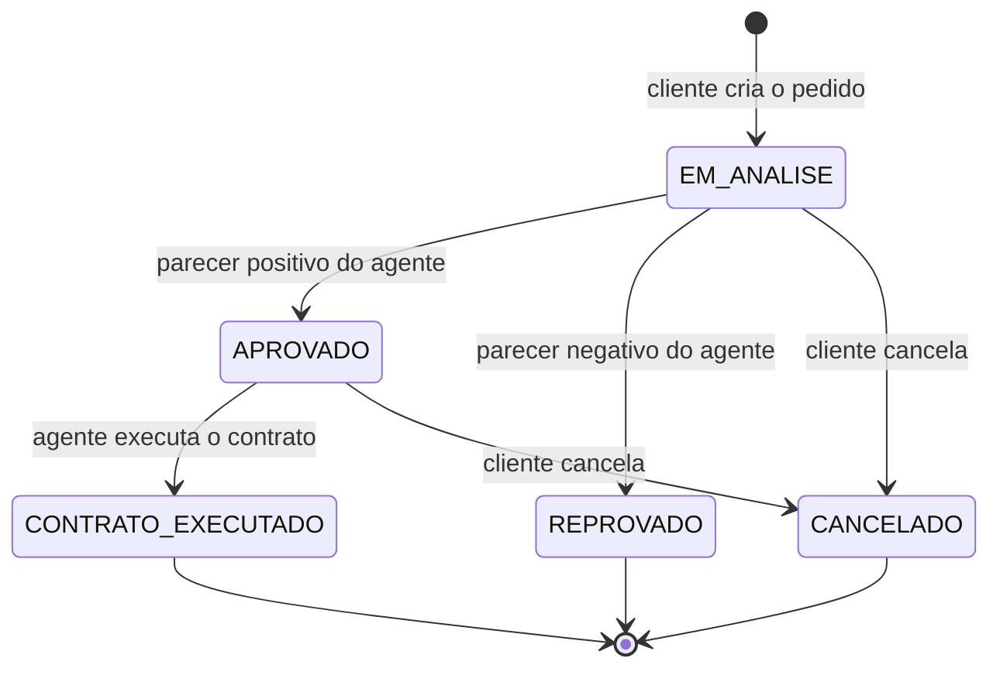

#### Mapa de endpoints da API

| Método             | Rota                       | Quem acessa              | Descrição                                     |
| :----------------- | :------------------------- | :----------------------- | :-------------------------------------------- |
| POST               | `/auth/login`              | Público                  | Autentica e devolve o token.                  |
| POST               | `/clientes`                | Público                  | Cadastra um cliente.                          |
| GET / PUT / DELETE | `/clientes/me`             | Cliente                  | Consulta, altera e exclui o próprio cadastro. |
| GET                | `/automoveis`              | Autenticado              | Lista os automóveis.                          |
| POST               | `/automoveis`              | Agente                   | Cadastra um automóvel.                        |
| PUT                | `/automoveis/{id}`         | Agente                   | Edita um automóvel (inclui o link da foto).   |
| GET                | `/pedidos`                 | Autenticado              | Cliente vê os seus pedidos; agente vê todos.  |
| GET                | `/pedidos/{id}`            | Autenticado              | Detalhe do pedido, com contrato e crédito.    |
| POST               | `/pedidos`                 | Cliente                  | Cria um pedido (status `EM_ANALISE`).         |
| PUT                | `/pedidos/{id}`            | Dono do pedido ou agente | Modifica um pedido em análise.                |
| PATCH              | `/pedidos/{id}/cancelar`   | Cliente                  | Cancela o pedido.                             |
| POST               | `/pedidos/{id}/avaliacoes` | Agente                   | Registra o parecer financeiro.                |
| POST               | `/pedidos/{id}/contrato`   | Agente                   | Executa o contrato de um pedido aprovado.     |
| POST               | `/pedidos/{id}/credito`    | Agente (banco)           | Associa o contrato de crédito.                |

---

## 🔧 Instalação e Execução

### Pré-requisitos

- **Java JDK:** versão **25** (Back-end Spring Boot)
- **Node.js:** versão LTS (v20.19 ou superior, ou v22+) (Front-end React)
- **Gerenciador de Pacotes:** npm
- **Conta no Supabase:** plano gratuito, para o banco PostgreSQL
- **Git**

---

### 🔑 Variáveis de Ambiente

#### 1 Back-end (Spring Boot)

Em desenvolvimento, as credenciais ficam no arquivo **`backend/src/main/resources/local.properties`**, que **não é versionado** (adicione `src/main/resources/local.properties` ao `.gitignore`). O `application.properties` carrega esse arquivo automaticamente. Em outros ambientes, use as variáveis de ambiente equivalentes.

| Propriedade (`local.properties`) | Variável de ambiente         | Descrição                                                        | Exemplo                                               |
| :------------------------------- | :--------------------------- | :--------------------------------------------------------------- | :---------------------------------------------------- |
| `spring.datasource.url`          | `SPRING_DATASOURCE_URL`      | URL JDBC do Supabase (Session pooler).                           | `jdbc:postgresql://<host-do-pooler>:5432/postgres`    |
| `spring.datasource.username`     | `SPRING_DATASOURCE_USERNAME` | Usuário do banco.                                                | `postgres.<id-do-projeto>`                            |
| `spring.datasource.password`     | `SPRING_DATASOURCE_PASSWORD` | Senha do banco.                                                  | `<senha-do-banco>`                                    |
| `app.jwt.secret`                 | `APP_JWT_SECRET`             | Chave para assinar os tokens (mínimo de 32 caracteres).          | `uma-frase-longa-e-secreta-com-mais-de-32-caracteres` |
| `app.jwt.expiration-minutes`     | `APP_JWT_EXPIRATION_MINUTES` | Validade do token, em minutos (padrão 120).                      | `120`                                                 |
| `app.cors.allowed-origins`       | `APP_CORS_ALLOWED_ORIGINS`   | Origens do front-end liberadas (padrão `http://localhost:5173`). | `http://localhost:5173`                               |

Existe um modelo em `backend/src/main/resources/local.properties.example`:

```properties
spring.datasource.url=jdbc:postgresql://<host-do-pooler>:5432/postgres
spring.datasource.username=postgres.<id-do-projeto>
spring.datasource.password=<senha-do-banco>
app.jwt.secret=troque-esta-frase-por-uma-bem-longa-e-secreta-123
```

#### 2 Front-end (React, Vite)

Crie um arquivo **`.env`** na raiz da pasta `/frontend` (copie de `.env.example`). Variáveis do Vite precisam do prefixo `VITE_`.

| Variável       | Descrição                         | Exemplo                 |
| :------------- | :-------------------------------- | :---------------------- |
| `VITE_API_URL` | URL base do back-end Spring Boot. | `http://localhost:8080` |

```
VITE_API_URL=http://localhost:8080
```

> ⚠️ Nunca coloque senhas ou chaves secretas em variáveis `VITE_`: elas ficam visíveis no código que vai para o navegador.

---

#### 3 Publicação opcional na Vercel

A publicação não é exigida, mas, se desejada, o **front-end** pode ir para a Vercel. O **back-end Spring Boot** precisa de outro serviço (por exemplo, Render ou Railway), pois a Vercel não mantém um servidor Java em execução.

No painel da Vercel (Project Settings > Environment Variables):

```
VITE_API_URL=https://url-publica-do-seu-backend
```

No serviço do back-end, defina as variáveis da tabela acima (`SPRING_DATASOURCE_URL`, `APP_JWT_SECRET` etc.) e coloque o endereço do site da Vercel em `APP_CORS_ALLOWED_ORIGINS`.

Como o front usa React Router, crie `frontend/vercel.json` para que atualizar a página em rotas como `/pedidos` não retorne 404:

```json
{ "rewrites": [{ "source": "/(.*)", "destination": "/index.html" }] }
```

---

### 📦 Instalação de Dependências

1.  **Clone o repositório:**

```bash
git clone <URL_DO_SEU_REPOSITÓRIO>
cd <pasta-do-projeto>
```

2.  **Instale as dependências** do Front-end e do Back-end separadamente.

#### Front-end (React)

```bash
cd frontend
npm install
cd ..
```

#### Back-end (Spring Boot)

O projeto usa o **Maven Wrapper**.

- **Windows (PowerShell):**

  ```powershell
  cd backend
  .\mvnw.cmd clean install -DskipTests
  cd ..
  ```

- **Linux / macOS:**
  ```bash
  cd backend
  ./mvnw clean install -DskipTests
  cd ..
  ```

---

### 💾 Inicialização do Banco de Dados (Supabase)

O projeto usa **PostgreSQL no Supabase**, sem Docker.

1. Crie uma conta em [supabase.com](https://supabase.com) e um **novo projeto**, guardando a **Database password**.
2. Clique em **Connect** e copie os dados da conexão **Session pooler**: host, porta `5432` e usuário (`postgres.<id-do-projeto>`).
3. Preencha o `local.properties` do back-end com esses dados (veja a seção de variáveis de ambiente).
4. **Esquema:** não é preciso criar tabelas à mão. Na primeira execução, o Hibernate cria `usuarios`, `clientes`, `rendimentos`, `agentes`, `empresas`, `bancos`, `automoveis`, `pedidos_aluguel`, `avaliacoes`, `contratos_aluguel` e `contratos_credito`.
5. **Dados iniciais:** na primeira execução, o back-end cria uma empresa, um banco e cinco automóveis de teste (veja _Usuários de teste_ abaixo).

---

### ⚡ Como Executar a Aplicação

Execute a aplicação em **dois terminais separados**.

#### Terminal 1: Back-end (Spring Boot)

```powershell
cd backend
.\mvnw.cmd spring-boot:run
```

No Linux/macOS, use `./mvnw spring-boot:run`.

🚀 _O Back-end estará disponível em **http://localhost:8080**. Procure no log a linha `Started AluguelCarrosApplication`._

---

#### Terminal 2: Front-end (React, Vite)

```bash
cd frontend
npm run dev
```

🎨 _O Front-end estará disponível em **http://localhost:5173**._

---

#### 👤 Usuários de teste

| Perfil           | Usuário                          | Senha                |
| :--------------- | :------------------------------- | :------------------- |
| Agente (empresa) | `locadora`                       | `locadora123`        |
| Agente (banco)   | `banco`                          | `banco123`           |
| Cliente          | criado pela tela **Cadastre-se** | definida no cadastro |

> Esses agentes e os cinco automóveis são criados automaticamente na primeira execução, quando ainda não há agentes cadastrados. Troque as senhas se o sistema for publicado.

**Roteiro rápido de demonstração:**

1. Cadastre um cliente e entre com ele.
2. Em **Novo pedido**, escolha um carro e as datas e envie.
3. Saia e entre como `locadora`; abra o pedido e registre o parecer **positivo**.
4. Execute o contrato (escolhendo o tipo, que define o proprietário do carro).
5. Entre como `banco`, abra o mesmo pedido e conceda o crédito.
6. Volte ao cliente e veja o contrato e o crédito no detalhe do pedido.

---

#### 🐳 Execução Local Completa com Docker Compose

Não utilizado neste projeto: o banco de dados é o Supabase (em nuvem), então basta executar os dois terminais acima.

---

## 🚀 Deploy

A publicação em produção é opcional. Para gerar os artefatos:

```bash
# 1. Build do Front-end (gera a pasta frontend/dist)
cd frontend
npm run build

# 2. Build do Back-end (gera o JAR em backend/target)
cd ../backend
./mvnw clean package
```

Execução do back-end a partir do JAR (com as variáveis de ambiente configuradas):

```bash
java -jar backend/target/AluguelCarros-0.0.1-SNAPSHOT.jar
```

O front-end (arquivos estáticos) pode ser servido por qualquer servidor web ou pela Vercel (veja a seção de variáveis de ambiente). Defina `SPRING_DATASOURCE_*`, `APP_JWT_SECRET` e `APP_CORS_ALLOWED_ORIGINS` no back-end e `VITE_API_URL` no front-end.

---

## 📂 Estrutura de Pastas

```
.
├── .gitignore                   # 🧹 Ignora local.properties, .env, node_modules, target etc.
├── README.md                    # 📘 Documentação principal do projeto.
├── LICENSE                      # ⚖️ Licença MIT.
│
├── /docs                        # 📚 Modelagem e documentação
│   ├── casos-de-uso.puml        #    Diagrama de casos de uso (PlantUML)
│   ├── diagrama-de-classes.puml #    Diagrama de classes (PlantUML)
│   ├── diagrama-de-pacotes.puml #    Diagrama de pacotes, visão lógica (PlantUML)
│   ├── historias-de-usuario.md  #    Histórias de usuário com critérios de aceite
│   ├── testes.md                #    Roteiro de testes manuais
│   └── /img                     #    Logo, diagramas exportados e capturas de tela
│
├── /frontend                    # 📁 Aplicação React + Vite
│   ├── .env.example             # 🧩 Variáveis de ambiente do Front-end.
│   ├── index.html
│   ├── /public                  # 📂 Arquivos estáticos (favicon).
│   ├── /src
│   │   ├── /components          # 🧱 Componentes reutilizáveis (Layout, cartões, linha do tempo...), cada um com seu .css
│   │   ├── /context             # 🔐 Contexto de autenticação (AuthProvider, useAuth).
│   │   ├── /pages               # 📄 Páginas (Login, Cadastro, Home, Pedidos, Perfil...), cada uma com seu .css
│   │   ├── /routes              # 🧭 Rotas e proteção por perfil.
│   │   ├── /services            # 🔌 Chamadas HTTP à API (Axios).
│   │   ├── /utils               # 🛠️ Funções utilitárias (datas, moeda, iniciais).
│   │   ├── index.css            # 🎨 Variáveis da paleta e estilos globais.
│   │   └── main.jsx
│   └── package.json             # 📦 Dependências e scripts.
│
└── /backend                     # 📁 Aplicação Spring Boot (MVC)
    ├── pom.xml                  # 🛠️ Build e dependências (Maven).
    ├── mvnw / mvnw.cmd          # Maven Wrapper
    └── /src/main
        ├── /java/com/example/AluguelCarros
        │   ├── AluguelCarrosApplication.java
        │   ├── /controller      # 🎮 Endpoints REST.
        │   ├── /service         # ⚙️ Regras e lógica de negócio.
        │   ├── /repository      # 🗄️ Repositórios (Spring Data JPA).
        │   ├── /model           # 🧬 Entidades persistentes (JPA) e enums.
        │   ├── /dto             # ✉️ Data Transfer Objects.
        │   ├── /exception       # 💥 Exceptions e handler global.
        │   └── /security        # 🛡️ Spring Security, filtro JWT e CORS.
        └── /resources
            ├── application.properties          # ⚙️ Configuração principal.
            └── local.properties.example        # 🧩 Modelo das credenciais locais.
```

---

## 🎥 Demonstração

> [!NOTE]
> As capturas abaixo mostram a interface com dados de exemplo.

### 📱 Aplicativo Mobile

Não se aplica. A interface é responsiva e se adapta a telas de celular.

### 🌐 Aplicação Web

|                                         Tela                                         |                                              Captura de Tela                                               |
| :----------------------------------------------------------------------------------: | :--------------------------------------------------------------------------------------------------------: |
|                                      **Login**                                       |                                          **Cadastro de cliente**                                           |
|         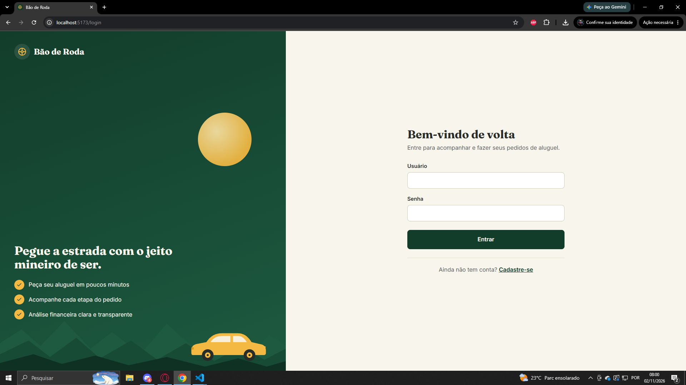         |           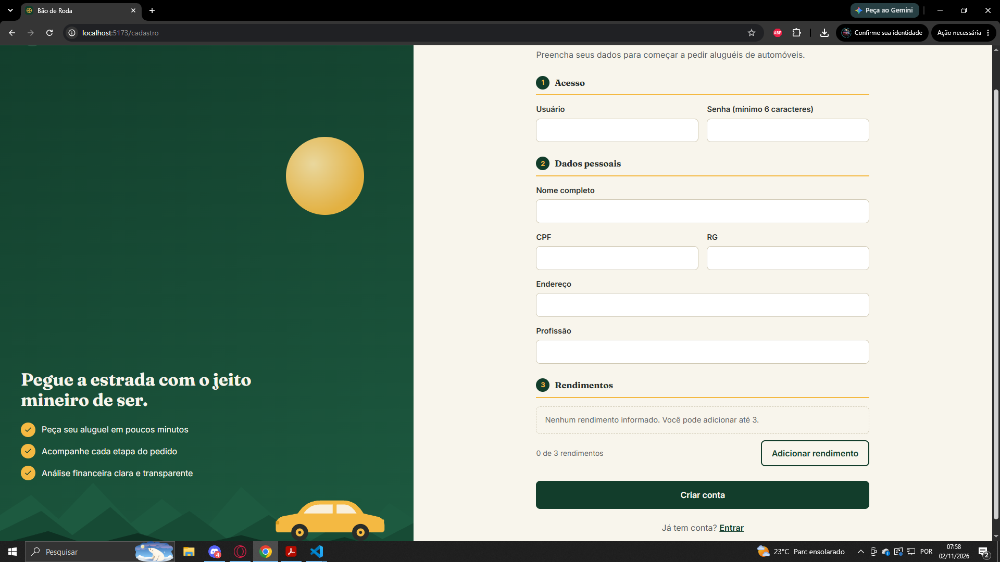            |
|                                  **Início (Home)**                                   |                                              **Meus pedidos**                                              |
|          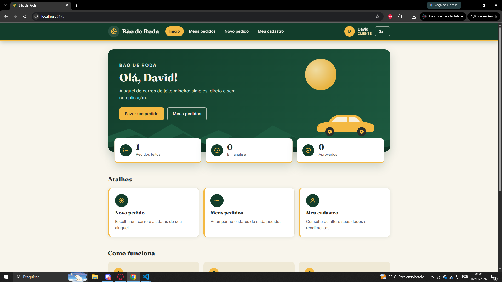          |                 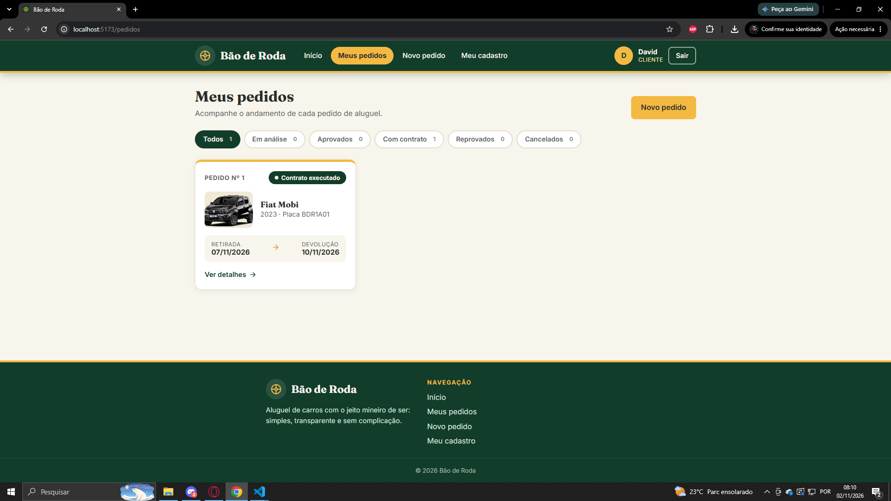                  |
|                                   **Novo pedido**                                    |                                     **Detalhe com contrato e crédito**                                     |
|       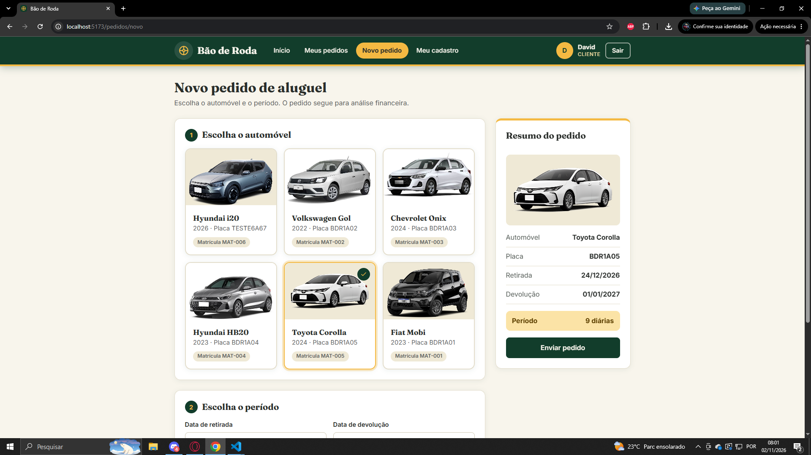       | 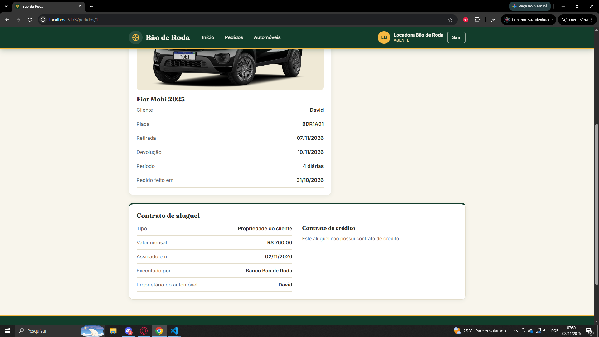 |
|                                   **Meu cadastro**                                   |                                          **Automóveis (agente)**                                           |
|         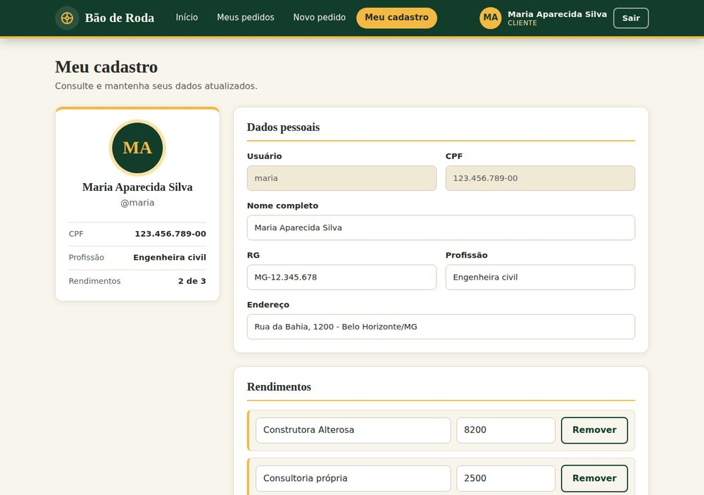         |          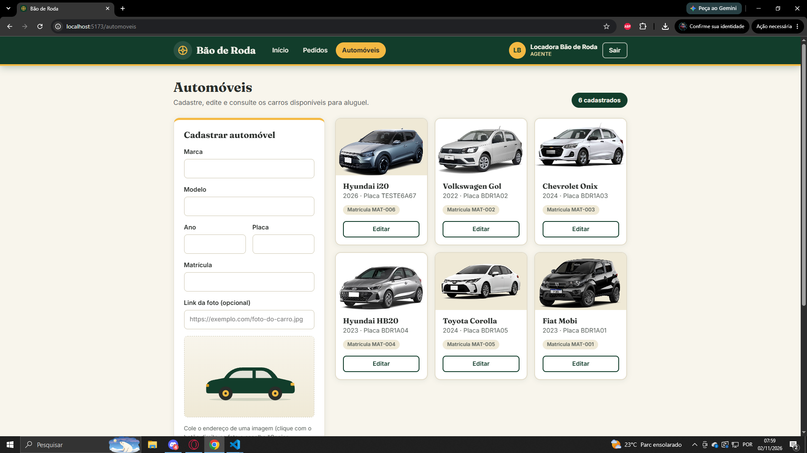           |
|                            **Executar contrato (agente)**                            |                                                                                                            |
| 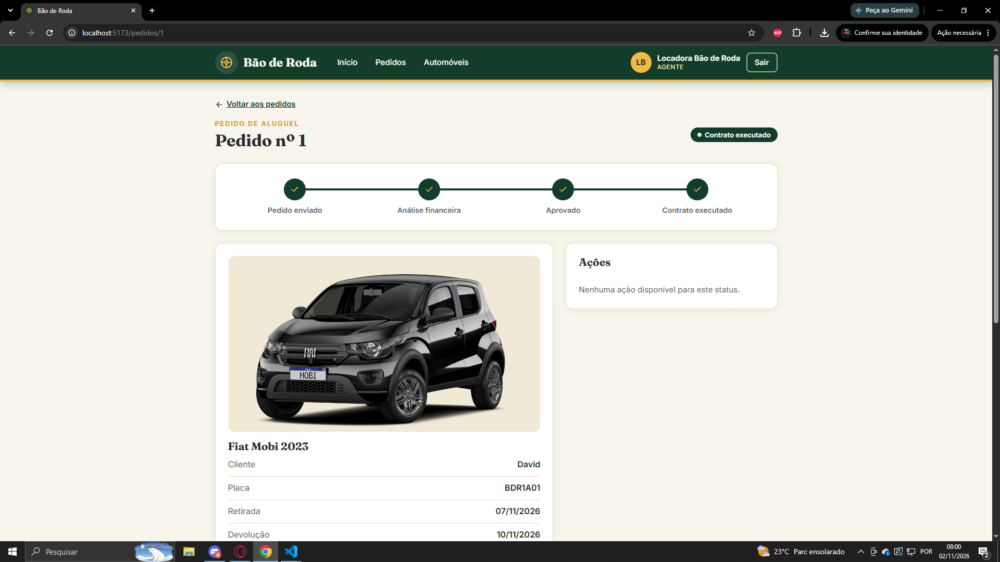 |                                                                                                            |

### 💻 Exemplo de Saída no Terminal (para Back-end, API, CLI)

#### 1. Login (exemplo com cURL)

```bash
curl -X POST 'http://localhost:8080/auth/login' \
     -H 'Content-Type: application/json' \
     -d '{"login": "locadora", "senha": "locadora123"}'
```

**Saída esperada:**

```json
{
  "token": "eyJhbGciOiJIUzI1NiJ9...",
  "usuario": {
    "id": 1,
    "nome": "Locadora Bão de Roda",
    "papel": "AGENTE",
    "tipoAgente": "EMPRESA"
  }
}
```

#### 2. Listagem de pedidos

```bash
curl -X GET 'http://localhost:8080/pedidos' \
     -H 'Authorization: Bearer <seu-jwt-token>'
```

**Saída esperada (exemplo):**

```json
[
  {
    "id": 4,
    "status": "EM_ANALISE",
    "dataPedido": "2026-11-02",
    "dataInicio": "2026-11-05",
    "dataFim": "2026-11-09",
    "automovel": {
      "id": 1,
      "matricula": "MAT-001",
      "ano": 2023,
      "marca": "Fiat",
      "modelo": "Mobi",
      "placa": "BDR1A01",
      "imagemUrl": null
    },
    "clienteNome": "Maria Aparecida Silva",
    "justificativaParecer": null,
    "contrato": null
  }
]
```

#### 3. Acesso sem login

```bash
curl -i 'http://localhost:8080/pedidos'
```

**Saída esperada:** `HTTP/1.1 401` (acesso negado sem token).

---

## 🧪 Testes

O projeto foi verificado com **testes manuais** de ponta a ponta, que cobrem login, CRUD de cliente, pedidos, análise, contrato, crédito e permissões. O roteiro completo, com os resultados esperados, está em [`docs/testes.md`](./docs/testes.md).

Verificações automáticas disponíveis:

```bash
# Front-end: análise estática e build de produção
cd frontend
npm run lint
npm run build
```

> O projeto não possui testes automatizados de unidade ou integração; essa é uma limitação conhecida (veja _Trade-offs e limitações_).

---

## 🔗 Documentações utilizadas

- 📖 **Front-end:** [React](https://react.dev/reference/react) · [Vite](https://vite.dev/) · [React Router](https://reactrouter.com/) · [Axios](https://axios-http.com/)
- 📖 **Back-end:** [Spring Boot](https://docs.spring.io/spring-boot/) · [Spring Data JPA](https://docs.spring.io/spring-data/jpa/reference/) · [Spring Security](https://docs.spring.io/spring-security/reference/) · [JJWT](https://github.com/jwtk/jjwt)
- 📖 **Banco de dados:** [Supabase](https://supabase.com/docs)
- 📖 **Modelagem:** [PlantUML](https://plantuml.com/) · [Mermaid](https://mermaid.js.org/)
- 📖 **Guia de estilo:** [Conventional Commits](https://www.conventionalcommits.org/en/v1.0.0/)
- 📖 **Documentação interna:** [Histórias de usuário](./docs/historias-de-usuario.md) · [Roteiro de testes](./docs/testes.md)

---

## 👥 Autores

| 👤 Nome                 | 🖼️ Foto                                                                                                                   | GitHub                                                                                                                                                                | 💼 LinkedIn                                                                                                                                                                                        | 📤 Gmail                                                                                                                                                            |
| ----------------------- | ------------------------------------------------------------------------------------------------------------------------- | --------------------------------------------------------------------------------------------------------------------------------------------------------------------- | -------------------------------------------------------------------------------------------------------------------------------------------------------------------------------------------------- | ------------------------------------------------------------------------------------------------------------------------------------------------------------------- |
| `David Aurélio Pedrosa` | <div align="center"></div> | <div align="center"><a href="https://github.com/DavidAurelio07"></a></div> | <div align="center"><a href="https://www.linkedin.com/in/david-aurélio-pedrosa-348aa92b5/"></a></div> | <div align="center"><a href="mailto:davidaureliop07@gmail.com"></a></div> |

---

## 🤝 Contribuição

Este é um projeto acadêmico, mas sugestões são bem-vindas.

1.  Faça um `fork` do projeto.
2.  Crie uma branch para sua feature (`git checkout -b feature/minha-feature`).
3.  Faça o commit das mudanças (`git commit -m 'feat: adiciona nova funcionalidade X'`), usando [Conventional Commits](https://www.conventionalcommits.org/en/v1.0.0/).
4.  Faça o `push` para a branch (`git push origin feature/minha-feature`).
5.  Abra um **Pull Request (PR)**.

---

## 🙏 Agradecimentos

- [**Engenharia de Software PUC Minas**](https://www.instagram.com/engsoftwarepucminas/) - Pelo apoio institucional e pela estrutura acadêmica.
- [**Prof. Dr. João Paulo Aramuni**](https://github.com/joaopauloaramuni) - Pelo enunciado do laboratório, pelo template de documentação e pelos ensinamentos de **Desenvolvimento e Integração de Aplicações Web**.

### Créditos

- **Tipografia:** [Fraunces](https://fonts.google.com/specimen/Fraunces) e [Inter](https://fonts.google.com/specimen/Inter), distribuídas pelo Google Fonts sob a licença SIL Open Font License.
- **Fotos dos automóveis:** informadas por link na tela de Automóveis. Fotos encontradas no google imagens`
- **Ícones e ilustrações:** desenhados para este projeto (SVG).

---

## 📄 Licença

Este projeto é distribuído sob a **[Licença MIT](./LICENSE)**.

---
